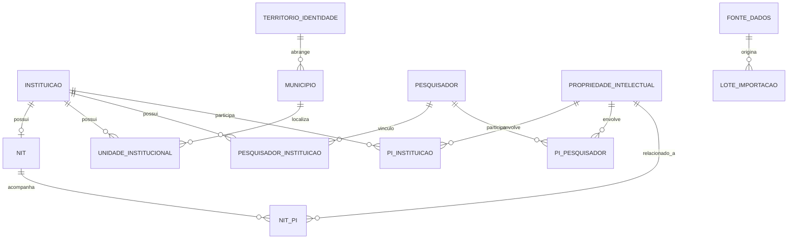

# Modelo de Dados — Backend

## 1. Objetivo

Este documento define o modelo de dados canônico do módulo de integração estadual dos NITs da Bahia.

O modelo orienta:

- Criação das tabelas PostgreSQL;
- Definição de chaves primárias e estrangeiras;
- Definição de restrições;
- Implementação de relacionamentos;
- Criação de migrações;
- Consultas da API;
- Integração com o ETL.

O backend é responsável pela estrutura física e pelas migrações do banco principal.

O ETL deve utilizar este modelo como contrato para carregar os dados.

O modelo poderá evoluir conforme a inspeção das fontes reais, desde que alterações sejam documentadas e comunicadas aos demais repositórios.

## 2. Escopo

O banco deve contemplar:

1. NITs;
2. Instituições/ICTs;
3. Unidades institucionais;
4. Pesquisadores;
5. Propriedade Intelectual;
6. Municípios;
7. Territórios de Identidade;
8. Fontes de dados;
9. Lotes de importação.

Não implementar nesta versão entidades relacionadas a:

- Transferência de Tecnologia;
- Contratos e licenciamentos;
- PROFNIT;
- Estruturas de inovação além dos NITs;
- Incubadoras;
- Parques tecnológicos;
- Anúncios e eventos;
- Equipe dos NITs.

## 3. Convenções gerais

Utilizar as seguintes convenções, salvo se o projeto existente possuir padrão diferente:

- Nomes de tabelas no singular ou plural de maneira consistente;
- Identificadores internos com chave primária;
- Chaves estrangeiras explícitas;
- Nomes de colunas em snake_case;
- Datas em tipos apropriados do PostgreSQL;
- Campos booleanos com nomes descritivos;
- Valores categóricos controlados;
- Restrições de integridade no banco.

Não misturar nomenclaturas em português e inglês dentro do mesmo padrão sem necessidade.

Reaproveitar as convenções existentes no repositório.

### 3.1 Identificadores

Utilizar identificadores internos para as entidades canônicas.

Os identificadores externos das fontes devem ser preservados em campos próprios.

Não utilizar diretamente identificadores externos como chave primária sem justificativa.

O identificador interno deve permanecer estável mesmo quando o registro da fonte sofrer alterações.

## 4. Entidades principais

### 4.1 Tabela: instituicao

Armazena as instituições/ICTs identificadas no projeto.

Campos propostos:

| Campo | Tipo conceitual | Restrição |
|---|---|---|
| id | Identificador | PK |
| nome | Texto | NOT NULL |
| sigla | Texto | NULL |
| natureza | Texto/categoria | NULL |
| tipo | Texto/categoria | NULL |
| site | Texto | NULL |
| descricao | Texto | NULL |
| id_municipio_sede | Identificador | FK, NULL |
| criado_em | Data/hora | NOT NULL |
| atualizado_em | Data/hora | NOT NULL |

A instituição pode existir sem NIT identificado.

O campo id_municipio_sede representa a localização da sede, e não necessariamente todas as unidades da instituição.

Não utilizar a localização da sede como localização automática de todos os campi.

### 4.2 Tabela: nit

Armazena os NITs identificados na Bahia.

Campos propostos:

| Campo | Tipo conceitual | Restrição |
|---|---|---|
| id | Identificador | PK |
| id_instituicao | Identificador | FK, NOT NULL, UNIQUE |
| nome | Texto | NOT NULL |
| sigla | Texto | NULL |
| descricao | Texto | NULL |
| site | Texto | NULL |
| email | Texto | NULL |
| situacao | Texto/categoria | NULL |
| id_municipio | Identificador | FK, NULL |
| criado_em | Data/hora | NOT NULL |
| atualizado_em | Data/hora | NOT NULL |

### Regra obrigatória NIT–Instituição

Cada NIT deve estar associado a exatamente uma instituição.

Uma instituição pode possuir no máximo um NIT.

A implementação deve utilizar:

- Foreign Key de nit.id_instituicao para instituicao.id;
- NOT NULL;
- UNIQUE.

Não criar tabela associativa NIT_INSTITUICAO.

A restrição UNIQUE garante que uma instituição não possa estar vinculada a múltiplos NITs.

A instituição poderá existir independentemente do NIT.

O campo id_municipio do NIT representa sua localização física, quando conhecida. Quando houver identificação de campus ou unidade, utilizar também o relacionamento com unidade_institucional, após validar a necessidade dessa associação.

### 4.3 Tabela: unidade_institucional

Representa campi, unidades de pesquisa e outras instalações de uma instituição.

Campos propostos:

| Campo | Tipo conceitual | Restrição |
|---|---|---|
| id | Identificador | PK |
| id_instituicao | Identificador | FK, NOT NULL |
| id_municipio | Identificador | FK, NULL |
| nome | Texto | NOT NULL |
| tipo | Texto/categoria | NULL |
| endereco | Texto | NULL |
| criado_em | Data/hora | NOT NULL |
| atualizado_em | Data/hora | NOT NULL |

Uma instituição pode possuir diversas unidades.

Cada unidade pertence a uma única instituição.

A implementação dessa tabela deve considerar a disponibilidade real dos dados.

Não criar registros de unidades apenas para preencher informações territoriais ausentes.

### 4.4 Tabela: pesquisador

Armazena pesquisadores identificados nas fontes do Observatório/SIMCC.

Campos propostos:

| Campo | Tipo conceitual | Restrição |
|---|---|---|
| id | Identificador | PK |
| nome | Texto | NOT NULL |
| id_simcc | Texto | UNIQUE, quando disponível |
| id_lattes | Texto | NULL |
| orcid | Texto | NULL |
| area_atuacao | Texto | NULL |
| criado_em | Data/hora | NOT NULL |
| atualizado_em | Data/hora | NOT NULL |

Identificadores externos devem ser normalizados.

Não utilizar nome como chave única.

Não armazenar CPF ou outros dados pessoais desnecessários.

Caso uma mesma pessoa apareça em diferentes fontes, buscar correspondência por identificadores confiáveis.

### 4.5 Tabela: propriedade_intelectual

Armazena registros de propriedade intelectual provenientes da BADEPI.

Campos propostos:

| Campo | Tipo conceitual | Restrição |
|---|---|---|
| id | Identificador | PK |
| identificador_badepi | Texto | UNIQUE, quando disponível |
| titulo | Texto | NULL conforme modalidade |
| tipo_pi | Texto/categoria | NOT NULL |
| numero_processo | Texto | NULL |
| data_deposito | Data | NULL |
| data_publicacao | Data | NULL |
| situacao | Texto/categoria | NULL |
| descricao | Texto | NULL |
| criado_em | Data/hora | NOT NULL |
| atualizado_em | Data/hora | NOT NULL |

A modalidade da PI deve preservar a classificação fornecida pela BADEPI.

Não presumir que todas as modalidades possuem os mesmos campos.

A modelagem deve começar com uma estrutura comum e evoluir para especialização somente quando a inspeção da fonte demonstrar necessidade.

A combinação entre identificador de origem, tipo de PI e número de processo deve ser avaliada para evitar duplicações.

Não estabelecer UNIQUE sobre número de processo isoladamente sem verificar sua semântica na BADEPI.

### 4.6 Tabela: municipio

Armazena os municípios utilizados nas associações territoriais.

Campos propostos:

| Campo | Tipo conceitual | Restrição |
|---|---|---|
| id | Identificador | PK |
| codigo_ibge | Texto | UNIQUE, NOT NULL |
| nome | Texto | NOT NULL |
| uf | Texto | NOT NULL |

O código IBGE será a principal referência de integração entre fontes.

### 4.7 Tabela: territorio_identidade

Armazena os Territórios de Identidade da Bahia.

Campos propostos:

| Campo | Tipo conceitual | Restrição |
|---|---|---|
| id | Identificador | PK |
| codigo | Texto | UNIQUE, quando disponível |
| nome | Texto | NOT NULL |
| descricao | Texto | NULL |

### 4.8 Relacionamento Município–Território

Cada município deverá estar associado ao seu Território de Identidade.

Para a implementação, utilizar uma chave estrangeira:

municipio.id_territorio -> territorio_identidade.id

O campo deverá ser obrigatório quando a base territorial estiver completa e validada.

Durante a preparação e validação inicial dos dados, poderá permanecer nulo até que a correspondência seja confirmada.

Não relacionar municípios a territórios apenas por semelhança textual.

## 5. Entidades associativas

### 5.1 Tabela: pesquisador_instituicao

Representa os vínculos institucionais dos pesquisadores.

| Campo | Tipo conceitual | Restrição |
|---|---|---|
| id | Identificador | PK |
| id_pesquisador | Identificador | FK, NOT NULL |
| id_instituicao | Identificador | FK, NOT NULL |
| id_unidade | Identificador | FK, NULL |
| tipo_vinculo | Texto | NULL |
| vinculo_principal | Booleano | NULL |
| data_inicio | Data | NULL |
| data_fim | Data | NULL |

Relacionamento N:N entre pesquisador e instituição.

Aplicar restrição de unicidade adequada para evitar duplicação do mesmo vínculo.

Quando houver histórico de vínculos, considerar as datas de início e fim.

Não assumir que todo vínculo identificado permanece ativo.

### 5.2 Tabela: pi_instituicao

Representa instituições envolvidas em registros de propriedade intelectual.

| Campo | Tipo conceitual | Restrição |
|---|---|---|
| id | Identificador | PK |
| id_pi | Identificador | FK, NOT NULL |
| id_instituicao | Identificador | FK, NOT NULL |
| papel | Texto/categoria | NOT NULL |

Exemplos de papel:

- Depositante;
- Titular;
- Outro papel fornecido pela fonte.

Uma PI pode estar relacionada a várias instituições.

Uma instituição pode estar relacionada a diversos registros de PI.

A restrição de unicidade deve considerar a PI, a instituição e o papel, quando a fonte permitir papéis múltiplos.

### 5.3 Tabela: pi_pesquisador

Representa pesquisadores envolvidos em registros de propriedade intelectual.

| Campo | Tipo conceitual | Restrição |
|---|---|---|
| id | Identificador | PK |
| id_pi | Identificador | FK, NOT NULL |
| id_pesquisador | Identificador | FK, NOT NULL |
| papel | Texto/categoria | NOT NULL |

Exemplos:

- Inventor;
- Autor;
- Criador;
- Outro papel identificado.

Não duplicar o registro principal de PI para representar múltiplos participantes.

### 5.4 Tabela: nit_pi

Relacionamento opcional entre NIT e propriedade intelectual.

| Campo | Tipo conceitual | Restrição |
|---|---|---|
| id | Identificador | PK |
| id_nit | Identificador | FK, NOT NULL |
| id_pi | Identificador | FK, NOT NULL |
| tipo_relacionamento | Texto/categoria | NULL |

A associação só deve ser criada quando houver evidência de gestão, acompanhamento ou participação do NIT.

A simples existência de uma PI vinculada à instituição não comprova o envolvimento do NIT.

## 6. Tabelas de procedência

O banco deve permitir rastrear a origem dos dados.

### 6.1 Tabela: fonte_dados

Representa as fontes de informações.

| Campo | Tipo conceitual | Restrição |
|---|---|---|
| id | Identificador | PK |
| nome | Texto | NOT NULL |
| categoria | Texto | NOT NULL |
| endereco | Texto | NULL |
| descricao | Texto | NULL |

Exemplos:

- DATANIT;
- Relatórios dos NITs;
- Observatório/SIMCC;
- BADEPI;
- Fontes institucionais.

### 6.2 Tabela: lote_importacao

Representa a execução dos pipelines de ETL.

| Campo | Tipo conceitual | Restrição |
|---|---|---|
| id | Identificador | PK |
| id_fonte | Identificador | FK, NOT NULL |
| data_inicio | Data/hora | NOT NULL |
| data_fim | Data/hora | NULL |
| periodo_referencia | Texto/data | NULL |
| arquivo_origem | Texto | NULL |
| situacao | Texto/categoria | NOT NULL |
| quantidade_extraida | Inteiro | NULL |
| quantidade_carregada | Inteiro | NULL |
| quantidade_rejeitada | Inteiro | NULL |
| detalhes_erro | Texto | NULL |

O lote de importação deve identificar a origem dos registros carregados.

A estrutura física dessa tabela deve ser compatibilizada com a implementação do ETL.

### 6.3 Procedência individual

Sempre que possível, as entidades principais devem manter:

- Identificador original da fonte;
- Lote de importação;
- Data de extração;
- Período de referência.

Caso uma entidade possua múltiplas fontes de origem, avaliar uma tabela de associação de procedência.

Evitar estruturas polimórficas que impeçam a integridade referencial sem justificativa técnica.

## 7. Diagrama entidade-relacionamento

O modelo conceitual de referência é:

## 8. Restrições de integridade

Implementar as restrições no banco sempre que possível.

### NIT–Instituição

- nit.id_instituicao deve ser NOT NULL;
- nit.id_instituicao deve ser FOREIGN KEY;
- nit.id_instituicao deve ser UNIQUE.

### Identificadores

- municipio.codigo_ibge deve ser UNIQUE;
- identificadores externos confiáveis devem possuir restrições de unicidade adequadas;
- evitar UNIQUE sobre campos que possam legitimamente se repetir.

### Relacionamentos

- Todas as FKs devem respeitar integridade referencial.
- Entidades associativas devem impedir duplicações.
- Relacionamentos opcionais devem permanecer nulos quando não houver evidência.

### Dados ausentes

Distinguir:

- Zero;
- Não informado;
- Não disponível;
- Não aplicável.

Não utilizar zero como substituto de NULL.

## 9. Índices

Avaliar índices para campos frequentemente utilizados em filtros e relacionamentos.

Priorizar:

- Chaves estrangeiras;
- Nome de instituição;
- Nome de NIT;
- Nome de pesquisador;
- Código IBGE;
- Tipo de PI;
- Número de processo;
- Datas de depósito e publicação.

Não criar índices indiscriminadamente.

A escolha deve considerar consultas reais e volume de registros.

## 10. Regras de modelagem

### Normalização

Evitar duplicação de dados.

Manter entidades independentes.

Utilizar tabelas associativas para relacionamentos N:N.

Não armazenar listas de identificadores em campos de texto ou arrays quando representarem relacionamentos entre entidades.

### Localização

A localização de uma instituição pode ser representada pela sede e por suas unidades institucionais.

O município de uma unidade deve determinar seu Território de Identidade.

Não replicar o nome do território em todos os registros sem necessidade.

### Propriedade Intelectual

Manter um registro principal por ativo.

Representar titulares, depositantes, inventores e autores separadamente.

Não presumir vínculo do NIT sem evidência.

## 11. Migrações

O backend é responsável pelas migrações do schema canônico.

Toda alteração estrutural deve possuir migração versionada.

Antes de criar ou modificar tabelas:

1. Verificar o schema existente.
2. Consultar as migrações anteriores.
3. Avaliar impacto no ETL.
4. Avaliar impacto na API.
5. Implementar migração.
6. Testar aplicação e reversão quando possível.

Não alterar diretamente o banco de produção.

Não permitir que o ETL controle as migrações do schema canônico.

## 12. Evolução do modelo

A estrutura apresentada representa o modelo de referência do MVP.

Os atributos definitivos devem ser ajustados após inspeção das fontes reais.

Qualquer alteração de cardinalidade, identificador ou entidade deve ser documentada.

O objetivo é manter um modelo consistente, normalizado e adequado à integração de diferentes fontes.
